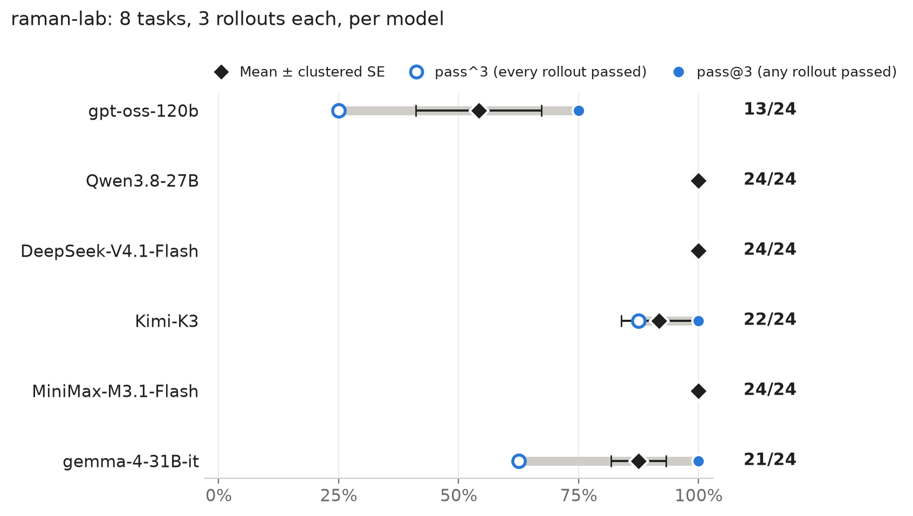
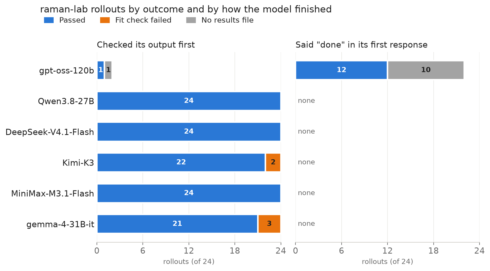
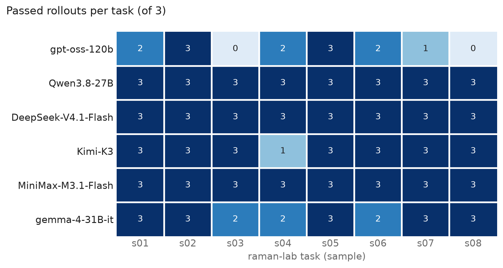

# raman-lab evals

This repository holds the code and results behind the Raman-fitting example in *Public Benchmarks won't save you! How to build better agentic evals*. It runs the Terminal-Bench 2 task [`raman-fitting`](https://hub.harborframework.com/tasks/terminal-bench/raman-fitting) and an adapted set of eight tasks, `raman-lab`, against six open-weight models. [Harbor](https://docs.harborframework.com/) runs the rollouts in an [HF Job](https://huggingface.co/docs/hub/jobs-overview). Each rollout gets its own [HF Sandbox](https://huggingface.co/docs/huggingface_hub/guides/sandbox), and [Inference Providers](https://huggingface.co/docs/inference-providers/index) serves the models.

The same trial folders, including every agent trajectory, are also on the Hugging Face Hub as the dataset [burtenshaw/raman-lab-runs](https://huggingface.co/datasets/burtenshaw/raman-lab-runs).

## Results (run of 2026-11-18)

Every model used the same harness (Terminus-2), the same tasks and three rollouts per task. The oracle passed all 9 tasks in the same run. Each model was pinned to one provider through the router's `:provider` suffix.

| Model | Provider | raman-fitting | raman-lab | Mean ± SE | pass@3 | pass^3 | Said "done" in first response |
|---|---|---|---|---|---|---|---|
| [gpt-oss-120b](https://huggingface.co/openai/gpt-oss-120b) | deepinfra | 0/3 | 13/24 | 0.54 ± 0.13 | 6/8 | 2/8 | 22/24 |
| [Qwen3.8-27B](https://huggingface.co/Qwen/Qwen3.8-27B) | deepinfra | 0/3 | 24/24 | 1.00 ± 0.00 | 8/8 | 8/8 | 0/24 |
| [DeepSeek-V4.1-Flash](https://huggingface.co/deepseek-ai/DeepSeek-V4.1-Flash) | deepinfra | 0/3 | 24/24 | 1.00 ± 0.00 | 8/8 | 8/8 | 0/24 |
| [Kimi-K3](https://huggingface.co/moonshotai/Kimi-K3) | deepinfra | 0/3 | 22/24 | 0.92 ± 0.08 | 8/8 | 7/8 | 0/24 |
| [MiniMax-M3.1-Flash](https://huggingface.co/MiniMaxAI/MiniMax-M3.1-Flash) | together | 0/3 | 24/24 | 1.00 ± 0.00 | 8/8 | 8/8 | 0/24 |
| [gemma-4-31B-it](https://huggingface.co/google/gemma-4-31B-it) | deepinfra | 0/3 | 21/24 | 0.88 ± 0.06 | 8/8 | 5/8 | 0/24 |

*raman-fitting and raman-lab columns count passed rollouts. Mean ± SE is the raman-lab pass rate with a standard error clustered by task. pass@3 and pass^3 count tasks out of 8.*

The cost of a rollout varies more than its score. The table below uses token counts from each trajectory and the router's list prices. It ignores cache discounts, so treat the cost column as an upper estimate.

| Model | Median tokens per raman-lab rollout | Median wall time (s) | Estimated cost, all 27 rollouts (USD) |
|---|---|---|---|
| gpt-oss-120b | 6,097 | 158 | 0.02 |
| Qwen3.8-27B | 50,883 | 237 | 0.86 |
| DeepSeek-V4.1-Flash | 62,432 | 126 | 0.70 |
| Kimi-K3 | 15,653 | 111 | 2.62 |
| MiniMax-M3.1-Flash | 91,495 | 212 | 0.60 |
| gemma-4-31B-it | 23,515 | 95 | 0.18 |







### What the traces show

The figures above summarise the scores. The traces explain three patterns behind them.

- **Only gpt-oss-120b declares completion before it sees output.** It called `mark_task_complete` in its first response in 22 of 24 raman-lab rollouts. No other model did this in any rollout. All 11 of its failures left no valid results file, and each of those traces shows a script failing on a missing NumPy or SciPy import.
- **No model passed the original `raman-fitting`.** The task's data file uses decimal commas and an x-axis unit the instruction does not state. Eight of the 15 rollouts from the newer models hit Harbor's 900-second agent timeout while working out that unit and which fitting window the reference uses. Five reported peak positions in the wrong units. Two Kimi-K3 rollouts fitted the right peaks and missed the offset or width tolerance on the 2D peak.
- **Kimi-K3 and gemma-4-31B-it lost raman-lab rollouts only on the fit-quality check.** Each of those five rollouts reported an I_D/I_G ratio within tolerance. In the four traces where the fitting range is visible, the agent fitted over a different window from the one the verifier scores. Whether those are model errors or a verifier that is too strict needs a domain expert's review.

## Repository layout

| Path | Contents |
|---|---|
| `scripts/build_dataset.py` | Generates the eight `raman-lab` tasks (synthetic spectra, instructions, reference fits, verifier) |
| `scripts/local_check.py` | Runs the oracle, a no-op agent and a shortcut baseline locally, without Docker |
| `scripts/naive_peak_heights.sh` | The shortcut baseline: reports peak heights without fitting |
| `scripts/hf_job_models.py` | The HF Job: builds the dataset, runs one model on both task sets, uploads the trial folders |
| `scripts/launch.sh` | Launches one HF Job per model |
| `scripts/analyze.py` | Builds `results/trials.csv`, `results/summary.csv` and `results/summary.md` |
| `scripts/figures.py` | Draws the matplotlib figures in `figures/` |
| `runs/2026-11-18/<model>/` | Raw Harbor job folders: `result.json`, ATIF `trajectory.json`, verifier output and terminal recordings for every rollout |
| `results/` | Per-rollout and per-model tables |

## Reproduce

Check the tasks locally first. The oracle should score 1.00, and the no-op and shortcut baselines should score 0.00.

```sh
uv venv --python 3.12 --seed .venv && .venv/bin/pip install numpy==2.3.1 scipy==1.16.0 matplotlib
.venv/bin/python scripts/build_dataset.py --out datasets/raman-lab
for agent in oracle nop naive; do .venv/bin/python scripts/local_check.py datasets/raman-lab $agent | tail -1; done
```

Then launch the jobs. You need an HF token with Jobs access, an org or user namespace to bill, and a dataset repo to receive the trial folders.

```sh
hf repos create <you>/raman-lab-runs --type dataset --private
RESULTS_REPO=<you>/raman-lab-runs NAMESPACE=<org> ./scripts/launch.sh
hf download <you>/raman-lab-runs --repo-type dataset --local-dir runs-download
.venv/bin/python scripts/analyze.py runs-download/runs/<date> results/
.venv/bin/python scripts/figures.py results/ figures/
```

To add a model, append its router ID to `MODELS` in `scripts/launch.sh`. The job exits early if the router does not serve that model from the named provider.

## Method notes

- **Pinned versions.** harbor 0.25.0, Terminus-2 2.0.0, task image `python:3.13-slim-bookworm`. The dataset seed is 20261109.
- **"Said done in its first response".** Terminus-2 exposes `mark_task_complete` as a tool. A rollout counts if that call appears in the model's first response, before it has seen any command output.
- **Clustered standard error.** Rollouts of the same task share its difficulty, so the standard error of the mean is clustered by task, following [Miller (2024)](https://arxiv.org/abs/2411.00640), equation 4.
- **One run.** These are results from a single run with three rollouts per task. Earlier runs of gpt-oss-120b on the same tasks scored 11/24 and 10/24.
